

**Engenheiro de Dados** · [Noron.dev](https://noron.dev) · São Paulo, SP

## Em 30 segundos

- **Dados:** lakehouse em Databricks e dbt em cliente real, com o tempo de apuração reduzido de até 20 para 2 dias; aqui, a mesma abordagem (Medallion, dbt, qualidade de dados) em projetos open source com dados públicos ou sintéticos, com testes e CI.
- **IA aplicada com avaliação:** RAG, fine-tuning e Text-to-SQL medidos com intervalo de confiança (IC) e avaliação como gate de CI.
- **Back-end:** Python/FastAPI em produção na Aira, produto de IA da Noron.dev, e um banco digital fictício em Java com concorrência medida.

Cada projeto abaixo segue o mesmo molde: o problema, a decisão principal, o resultado medido e a stack; os projetos abertos trazem também os links. Nos projetos abertos, cada número vem de um teste ou de uma medição versionada no repositório; a Aira tem código fechado, e seus números vêm do repositório privado e da operação, não de repositório público. Os projetos abertos são feitos com apoio de assistente de IA; o escopo, as decisões de arquitetura e as medições são meus, e revisei o resultado.

## Em produção: Aira

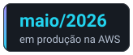

**Aira**, produto de IA da Noron.dev, em produção na AWS desde maio/2026, em instância dedicada por cliente. Respondo pelo desenvolvimento e pela operação. Código fechado: os números abaixo vêm do repositório privado e da operação, e não podem ser conferidos num repositório público.

- **Problema:** cada pessoa da empresa precisa perguntar, em português, sobre os arquivos da própria empresa e receber a resposta com a fonte, sem acesso ao que não tem permissão de ver.
- **Decisão:** conduzi o desenho da IA com ferramentas só de leitura (recuperação agêntica), confinada às pastas que cada pessoa tem permissão de ver, com os arquivos consultados listados como fonte; e a avaliação das respostas antes de mudar prompt, modelo ou esforço.
- **Resultado:** mais de 30 casos de avaliação em 7 categorias (dados fictícios, conferência determinística); fila, limite por minuto, cota mensal e teto de gasto no uso da IA; mais de 5.000 testes automatizados de back-end; trilha de auditoria encadeada por hash, que detecta adulteração; backup diário com cópia externa cifrada; mais de 60 versões publicadas.
- **Stack:** Python/FastAPI · SvelteKit · PostgreSQL · Docker · AWS

## Engenharia de dados

### oss-lakehouse — lakehouse sobre dados reais do GitHub

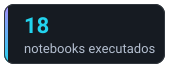
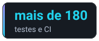

- **Problema:** aprender e mostrar engenharia de dados em Databricks sem depender de conta de nuvem, sobre dados reais.
- **Decisão:** o mesmo código roda localmente (PySpark e Delta Lake) e no Databricks (job em Declarative Automation Bundles, antes Databricks Asset Bundles). A infraestrutura Azure está em Terraform, verificada com `terraform validate`, sem `apply`.
- **Resultado:** 18 notebooks executados, com o resultado na própria célula, e um pacote Python com mais de 180 testes e CI. Cobre ingestão incremental, MERGE e SCD2, Structured Streaming, modelagem dimensional, qualidade e contratos, performance no Spark com data skew real, governança e LGPD, e IA dentro do pipeline avaliada contra gabarito.
- **Stack:** PySpark · Delta Lake · Databricks · Terraform · GitHub Actions
- **Links:** [repositório do oss-lakehouse](https://github.com/alanjoffre/oss-lakehouse) · [guia de estudo com 199 perguntas respondidas](https://github.com/alanjoffre/oss-lakehouse/blob/main/GUIA_DE_ESTUDO.md)

### toll-analytics-platform — plataforma de dados de ponta a ponta

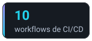
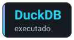
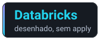

- **Problema:** construir do zero, com ferramentas abertas e dados sintéticos, uma plataforma de dados completa. O repositório não contém código, dado nem regra de empregador ou cliente.
- **Decisão:** desenvolvimento em DuckDB, sem custo e reprodutível; desenhado para Databricks sem alterar o SQL (infraestrutura em Terraform, verificada com `terraform validate`, sem `apply`).
- **Resultado:** modelagem Medallion com contracts, unit tests, Semantic Layer e dbt Mesh; CI/CD com 10 workflows (Slim CI, gate de Data Quality, promoção de staging para produção); [dashboard ao vivo](https://alanjoffre.github.io/toll-analytics-platform/).
- **Stack:** dlt · dbt · Airflow com Cosmos · Soda · OpenLineage · Evidence.dev · Kafka (Redpanda) · Terraform
- **Links:** [repositório do toll-analytics-platform](https://github.com/alanjoffre/toll-analytics-platform) · [dashboard ao vivo](https://alanjoffre.github.io/toll-analytics-platform/)

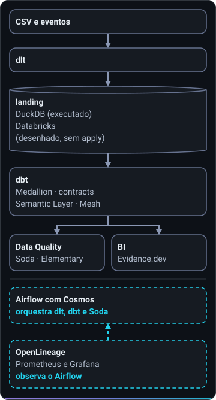

## Engenharia de IA

### RodoIA — engenharia de IA de ponta a ponta

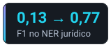
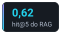
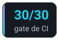

- **Problema:** ir além de "chamar a API de um modelo": do backpropagation escrito à mão ao serving em produção, sobre a regulação e os dados abertos da ANTT.
- **Decisão:** motor de dados escolhido por benchmark (DuckDB 6,7 vezes mais rápido que o Spark, sem divergências) e avaliação como gate de CI, que barra a entrega quando a qualidade cai.
- **Resultado:** RAG com hit@5 de 0,62 (IC 0,48 a 0,74) e precisão de citação de 0,92; fine-tuning QLoRA em NER jurídico (reconhecimento de entidades) com F1 de 0,13 para 0,77, servido com vLLM a 205 tokens/s; agente em LangGraph com roteamento de 0,95 (n=21); gate 30/30 e 302 testes (285 no CI).
- **Stack:** PyTorch · Hugging Face · Qdrant · LangGraph · vLLM · DuckDB · MLflow · DVC
- **Links:** [repositório do RodoIA](https://github.com/alanjoffre/rodoia) · [demo ao vivo](https://huggingface.co/spaces/alanjoffre/rodoia-rag) · [a história do projeto](https://github.com/alanjoffre/rodoia/blob/main/docs/HISTORIA.md)

O diferencial não são os números altos, e sim o rigor de corrigir os próprios números: o conjunto held-out desfez a memorização, o backtest desfez uma escolha a dedo e a auditoria humana encontrou 16% dos rótulos de referência errados.

### RodoQuery — Text-to-SQL sobre camada semântica

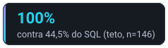
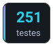

- **Problema:** um modelo que escreve SQL direto sobre dados governados devolve respostas plausíveis e erradas; o projeto mede quanto uma camada semântica corrige isso.
- **Decisão:** o modelo não escreve SQL: escolhe métricas e dimensões de um vocabulário fechado (camada semântica, ou Semantic Layer, com MetricFlow), e quem gera o SQL é o MetricFlow. Fora do catálogo, o sistema se abstém. A avaliação é por execução: o resultado do SQL gerado é comparado com o do gabarito.
- **Resultado:** em dados reais da ANTT (n=146 perguntas respondíveis), com modelo de ponta via API, 100% (IC 97,4 a 100) contra 44,5% do SQL direto; com modelo local de 7B, 89,7% contra 26,7%. O 100% é teto do instrumento: o teste saturou e não distingue sistemas melhores. A vantagem foi menor com o modelo mais forte (+55,5 pontos contra +63,0). 251 testes.
- **Stack:** Python · MetricFlow (dbt) · DuckDB · FastAPI · Docker · Kubernetes
- **Links:** [repositório do RodoQuery](https://github.com/alanjoffre/rodoquery) · [fundação de dados (dbt e MetricFlow sobre os dados da ANTT)](https://github.com/alanjoffre/antt-foundation)

### NãoConsta — RAG contratual avaliado pelo que recusa

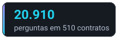
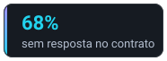

- **Problema:** um agente de contratos que sempre responde inventa quando a cláusula não existe.
- **Decisão:** medir o agente pela capacidade de responder "não consta no contrato" quando a resposta não existe, e não só pelo acerto.
- **Resultado:** benchmark CUAD com 510 contratos e 20.910 perguntas, 68% delas sem resposta no contrato. Em 200 consultas estratificadas, com modelo local de 7B e sem juiz de IA, o agente se absteve em 90% a 91% dos casos sem resposta e acertou 33% das perguntas com resposta (62% no total). 3 de 5 previsões minhas foram refutadas. O teste com um modelo mais capaz está em aberto, declarado no repositório. 68 testes.
- **Stack:** Python · PostgreSQL (pgvector) · LangGraph · MCP · Ollama
- **Links:** [repositório do NãoConsta](https://github.com/alanjoffre/naoconsta)

## Back-end em Java

### Ledgerly Bank — banco digital fictício em Java

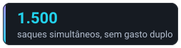
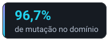
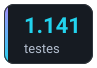

- **Problema:** mostrar back-end de sistema financeiro com consistência de saldo sob concorrência, construído do zero e em público.
- **Decisão:** razão contábil em partidas dobradas e Pix com Saga, Outbox e Kafka; extrato em CQRS (MongoDB).
- **Resultado:** saldo sem gasto duplo sob 1.500 saques simultâneos; 1.141 testes, 96,7% de mutação no domínio, 92,6% de cobertura e contratos com Pact; 47 ADRs (registros de decisão de arquitetura).
- **Stack:** Java 25 · Spring Boot · Quarkus · Kafka · MongoDB · Keycloak · ONNX · React
- **Links:** [repositório do Ledgerly Bank](https://github.com/alanjoffre/ledgerly-bank)

## Trabalhos anteriores: machine learning

<b>Ver uma seleção de 4 projetos de ML aplicado</b>

 

- [Detecção de anomalias em tarifas](https://github.com/alanjoffre/data-science/tree/master/projetos/logistica_transporte/4_deteccao_de_anomalias_em_tarifas) — modelos supervisionados e não supervisionados em tarifas de viagens compartilhadas.
- [Clusterização de séries temporais](https://github.com/alanjoffre/data-science/tree/master/projetos/logistica_transporte/3_analise_desempenho_viagens_agrupadas_clusterizacao_series_temporais) — janelas sobrepostas e clusterização (K-Shape, DBSCAN), com Optuna e MLflow.
- [Detecção de fraude em cartão](https://github.com/alanjoffre/data-science/tree/master/projetos/creditcard_fraud_detection) — Random Forest para detectar fraude, servido em streaming com Flask e Kafka.
- [Reconhecimento facial e detecção de objetos](https://github.com/alanjoffre/data-science/tree/master/projetos/reconhecimento_facial_e_deteccao_de_objetos) — visão computacional em tempo real, integrada a uma aplicação web.

Os demais projetos de ciência de dados estão no repositório [data-science](https://github.com/alanjoffre/data-science).

